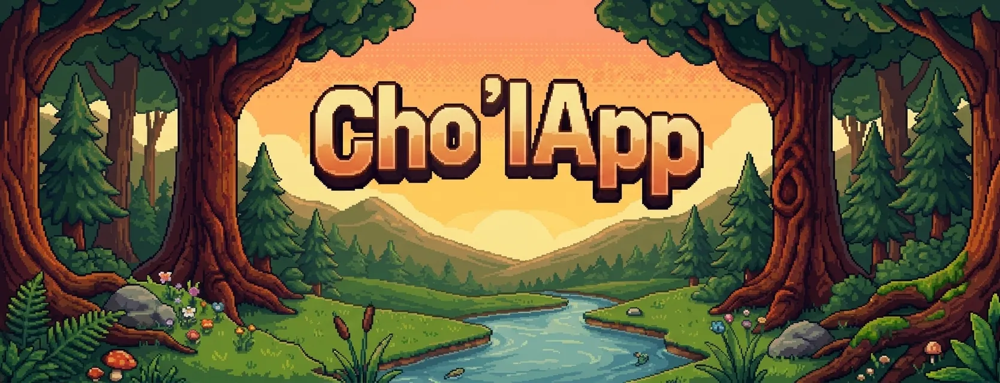

# Cho'lApp
Apliacion movil para la enseñanza, preservacion y revitalizacion del chol en el
estad de tabasco.



### Patron de arquitectura MVVM (estructura propuesta)

```bash
lib/
├── core/                   # Temas, constantes globales, extensiones
├── data/                   # Repositorios y fuentes de datos (Drift, almacenamiento local)
│   ├── database/           # Configuración de Drift (SQLite / Web)
│   ├── repositories/       # Repositorio de palabras y progreso del usuario
│   └── models/             # Modelos de datos de la base de datos
├── domain/                 # Entidades y reglas de negocio puras del Ch'ol
│   └── entities/           # Modelo de palabra, módulo, puntaje
├── ui/                     # Interfaz de usuario organizada por características
│   ├── core/               # Widgets compartidos (botones con tu estilo de diseño)
│   ├── themes/             # Estilos y colores
│   ├── themes/             # Estilos y colores
│   ├── modules/            # Módulo de aprendizaje (Familia, Escuela, etc.)
│   │   ├── view_models/    # Providers de Riverpod para este módulo
│   │   └── screens/        # Pantalla de selección de palabras
    │── screens/            # vistas de pantallas
│   └── game_canvas/        # [Flame] El motor de juegos 2D y el pixel art
├── main.dart               # Punto de entrada principal
├── main_test.dart          # Punto de entrada para pruebas locales/desarrollo

```
